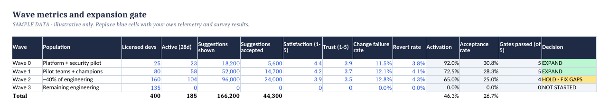
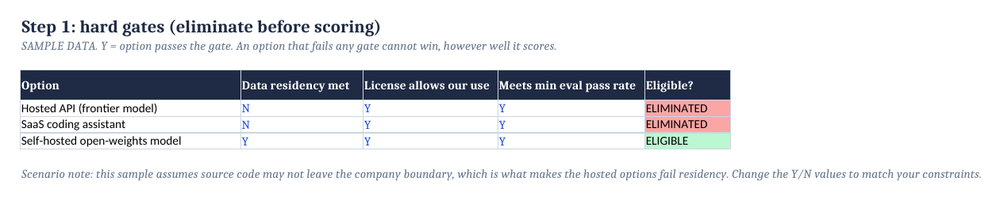

# Scaling GenAI Across Engineering

**How I led AI-assisted development for 400+ developers, and the operating model behind it.**
By [Brandon Nissl](https://www.linkedin.com/in/brandonnissl), Senior Staff Technical Program Manager.

| 400+ | 2.2x | 450+ |
|---|---|---|
| developers on AI-assisted development | sprint velocity during the program | microservices migrated to Kubernetes (same discipline, earlier program) |

## Read this first
📖 **[Case study: Scaling AI-assisted engineering to 400+ developers](case-study/scaling-ai-assisted-engineering.md)**
The thesis, the four-move operating model (pilot, champions, training, policy), the model decision (hosted vs. self-hosted Qwen), and how to measure it without fooling yourself.

## The working artifacts
Excel / Google Sheets workbooks with live formulas. Download, open in Google Sheets or Excel, replace the blue cells with your own numbers. All data inside is **illustrative sample data**.

| Artifact | What it does |
|---|---|
| [AI Rollout Tracker](artifacts/AI-Rollout-Tracker.xlsx) | Wave gates (adoption, satisfaction, trust, change-failure, revert), champion coverage, difference-in-differences impact model, value range |
| [Model Decision Matrix](artifacts/Model-Decision-Matrix.xlsx) | Hard gates (residency, license, evals), weighted scoring, 3-year TCO and break-even for hosted vs. SaaS vs. self-hosted |

## Open to roles
Senior Staff / Principal TPM and AI transformation leadership. [LinkedIn](https://www.linkedin.com/in/brandonnissl)

MIT License. Sample data is illustrative; not legal or compliance advice.
