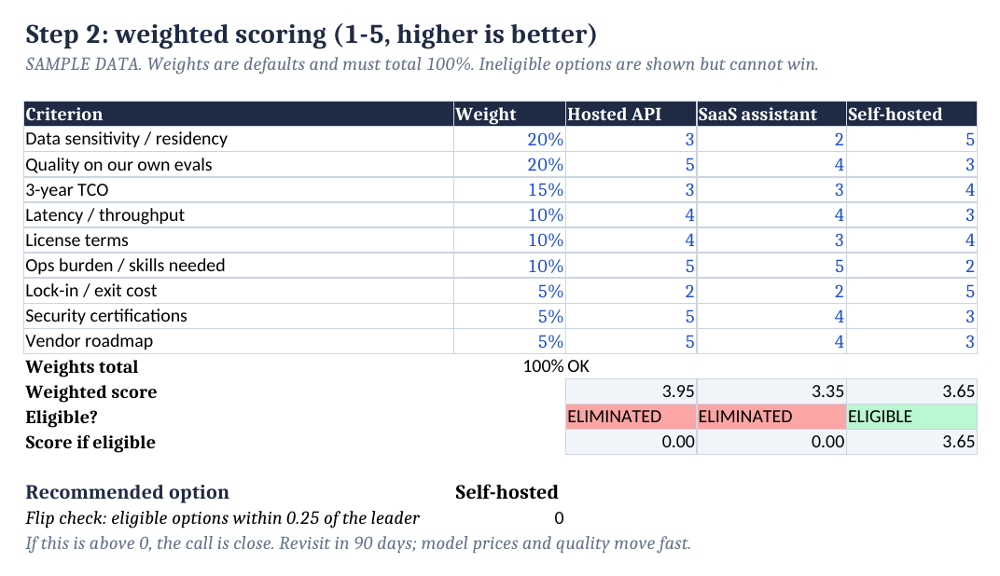
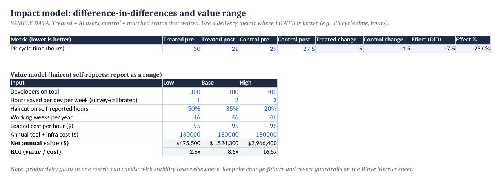

# Scaling AI-assisted engineering to 400+ developers

*A case study by Brandon Nissl, Senior Staff Technical Program Manager*

## The short version

At a fintech platform, I led the rollout of AI-assisted development across **400+ developers**. Sprint velocity rose **2.2x** over the program. I did not get there by buying licenses and sending an announcement. I got there by treating it as a platform migration for how people work: a measured pilot, a champion network, real training, and an engineering policy with teeth. The tools were BMAD, Claude, and a self-hosted Qwen model that we chose for cost and data governance.

## The thesis

AI coding tools rarely fail on model quality. They fail on the operating model around them: nobody owns adoption, nobody measures anything honestly, security says no because nobody asked early, and the loudest skeptic sets the culture.

I have spent 15 years moving organizations from one platform to another, from an AS400 shutdown to a 450+ microservice Kubernetes migration. Rolling out AI to engineers is the same job. You are moving a large organization onto a new way of working without breaking what already works. The discipline transfers directly: waves, gates, owners, rollback, and numbers.

## The operating model

The program ran on four moves: pilot teams, champions, training, and policy. Here is how I think about each one.

**1. Pilot before you scale.** Start with pilot teams, not a company-wide launch. A pilot is only worth running if it can change your mind, so I run waves with gates that must pass before the next one starts. The [rollout tracker](../artifacts/AI-Rollout-Tracker.xlsx) is how I structure that.

**2. Champions, not mandates.** Adoption spreads through trusted peers who show teammates what works in their own codebase. A mandate gets compliance. A champion gets curiosity.

**3. Training that builds skill, not awareness.** Using an AI assistant well is a skill: giving it context, reviewing what it produces, writing tests first, handling secrets and data safely. Training should teach those skills, by role, and check that people can do them.

**4. Policy before incident.** The program shipped a new engineering policy. Good policy covers approved tools, data handling, and expectations for reviewing AI-generated code. Engineers move faster when the rules are clear, and security teams say yes sooner when the rules exist before the question is asked.

## The model decision: why not just buy one tool

The rollout used more than one model on purpose. For the self-hosted option, **Qwen**, the deciding factors were **cost** and **data governance**: controlling where code and context go, and what high-volume usage costs over time.

The right way to make this call is to run it through hard gates before scoring. If an option fails data residency or license terms, it is out, however good its benchmark. Then you score the survivors on your own evaluations, not a leaderboard, and you model three-year cost at your real volume. The [decision matrix](../artifacts/Model-Decision-Matrix.xlsx) makes that reasoning explicit.

The honest tension is cost. A hosted API can be cheaper at modest volume, and self-hosting has fixed GPU and staffing costs. The [TCO model](../docs/images/tco.png) shows where the break-even sits. Governance can justify paying more. Say that out loud instead of pretending the spreadsheet decided it.

## Measuring it honestly

Velocity went up 2.2x, and I treat that as a headline, not proof. A faster team that ships more regressions has not improved. My approach pairs speed with guardrails: change failure rate, revert rate, review time, and developer trust. In the tracker, a wave expands only when it passes all of them.

For the question every executive asks, "how much is it worth," the impact model in the [tracker](../artifacts/AI-Rollout-Tracker.xlsx) compares AI users against comparable teams that have not started yet (difference-in-differences) and reports value as a range, with self-reported hours discounted.

> The workbooks in this repo contain **illustrative sample data**, not any employer's figures. Replace the blue cells with your own numbers.

## What I would tell another TPM

1. **Own adoption, not just delivery.** A tool nobody uses is a failed program with a green status.
2. **Let data move the next wave.** Gates beat enthusiasm in both directions.
3. **Bring security in first.** The cheapest policy conversation is the one you start before the incident.
4. **Pair every speed metric with a quality metric.** Otherwise you will optimize your way into a worse system.
5. **Use the playbook you already have.** Large migrations, PMO governance, and exec reporting are exactly the muscles AI adoption needs.

## Where this fits in my work

| Era | Program |
|---|---|
| 2015 | Shut down a legacy AS400 on time in a $2.5M engagement |
| 2020-2021 | Built a PMO from scratch; moved off proprietary hardware to AWS |
| 2021-2023 | Founded Core Infrastructure; saved $1.4M a year (Grafana to Datadog) |
| 2023-now | Built the TPM function; 450+ microservices to Kubernetes; AI-assisted development for 400+ developers |

[Find me on LinkedIn](https://www.linkedin.com/in/brandonnissl).
